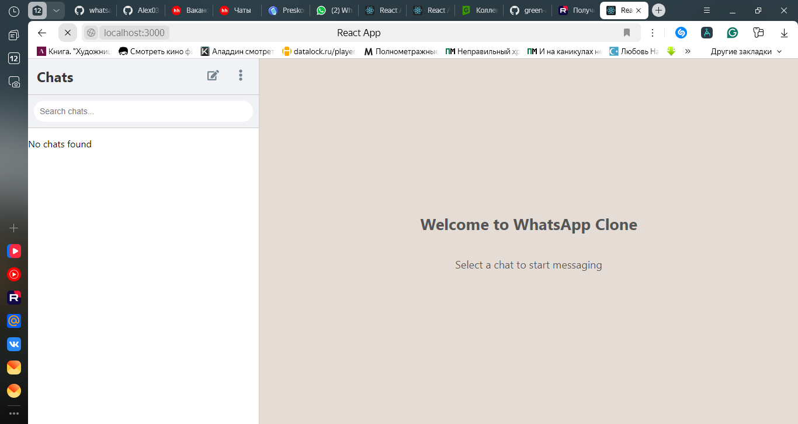
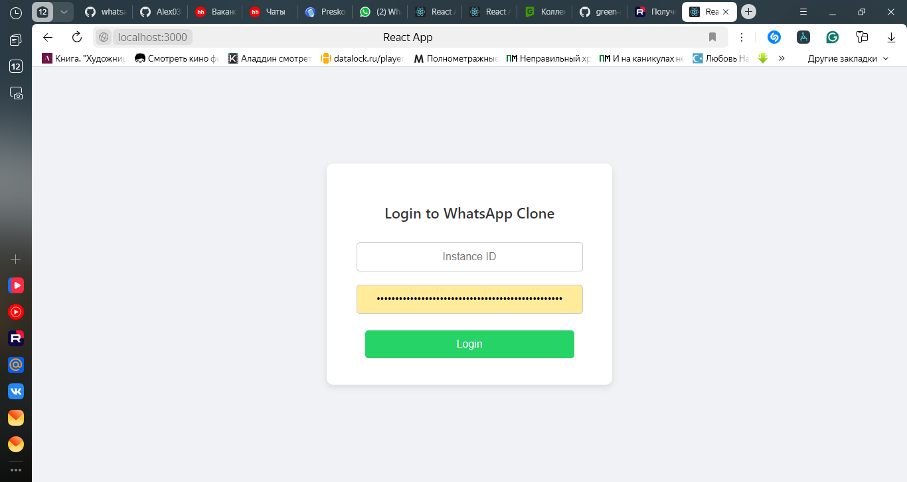
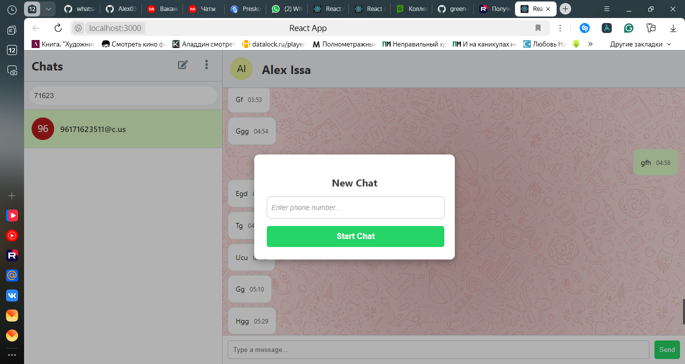
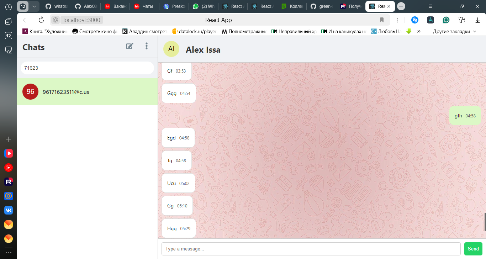
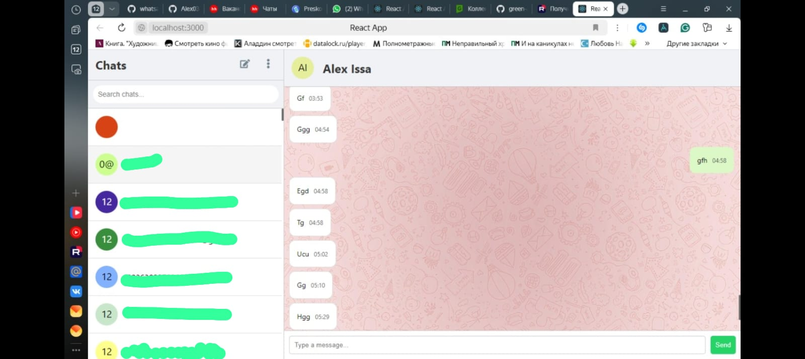
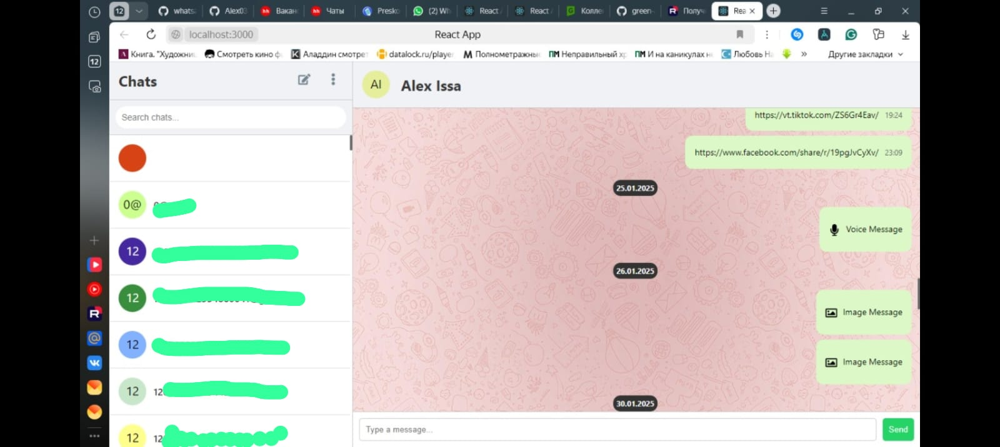
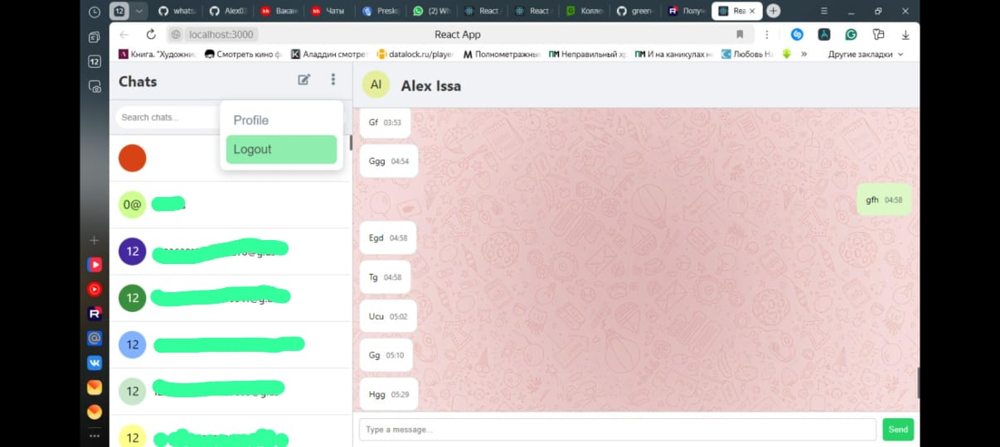

# WhatsApp Chat

[Русская версия](README.ru.md)

A WhatsApp Web style chat client built with React on top of [GREEN-API](https://green-api.com/). Log in with a GREEN-API instance, see your chats, read the history, send text messages and receive new messages live.



## Features

- **Login with a GREEN-API instance**: enter `idInstance` and `apiTokenInstance`; the app checks that the instance is authorized.
- **Chat list** with search, last-message preview and unread counters. Chats that receive a message move to the top, and new chats appear automatically.
- **Chat window** with contact name and avatar, message history (scroll up to load older messages), date separators and text, image, audio, video and document messages.
- **Send messages** to an existing chat or start a new chat with a phone number.
- **Live updates**: one notification loop for the whole app (HTTP polling of `ReceiveNotification`), or an optional webhook relay pushing notifications over socket.io.

| Login | New chat | Receiving a message |
|-------|----------|---------------------|
|  |  |  |

| Contact info | Message types | Logout |
|--------------|---------------|--------|
|  |  |  |

## Tech stack

- React 19 (Create React App), React Router 7, axios, react-icons
- GREEN-API HTTP API
- Optional webhook relay: Node.js, Express, socket.io

## Getting started

Requirements: Node.js 18+ and a GREEN-API instance that is linked to a WhatsApp account (status "authorized").

```bash
git clone https://github.com/Alex03issa/whatsapp-chat.git
cd whatsapp-chat
npm install
npm start
```

Open http://localhost:3000 and log in with your instance's `idInstance` and `apiTokenInstance` from the GREEN-API console.

Other scripts:

| Command | What it does |
|---------|--------------|
| `npm run build` | Production build in `build/` |
| `npm test` | Unit tests |
| `npm run server` | Optional webhook relay (see below) |

> The instance token is stored in this browser's `localStorage` and sent to GREEN-API in the request URL, which is how GREEN-API authenticates. Use it on your own machine only, and log out to remove it.

## How receiving messages works

GREEN-API keeps incoming events in a notification queue. The app reads it in one place:

1. `useIncomingNotifications` (in `src/hooks/`) calls `ReceiveNotification` in a loop. The request waits up to a few seconds for a new event.
2. Each notification is passed to `Home`, which updates the chat list (preview, unread counter, order) and forwards the message to the open `ChatWindow` if it belongs to that chat.
3. The notification is then removed with `DeleteNotification` so the next one can be received.

The loop is stopped with an `AbortController` when you log out or the page is closed, and it backs off for 5 s after an error.

### Optional: webhook relay

Instead of polling, GREEN-API can POST notifications to a webhook. `server.js` receives them on `POST /webhook` and pushes them to the app over socket.io.

```bash
npm run server                                   # relay on http://localhost:5000
REACT_APP_WEBHOOK_SOCKET_URL=http://localhost:5000 npm start
```

GREEN-API must be able to reach the relay, so expose it publicly (for example with a tunnel) and set `https://<your-host>/webhook` as the webhook URL in the instance settings. Server settings: `PORT` (default 5000), `CLIENT_ORIGIN` (default `http://localhost:3000`) and `WEBHOOK_TOKEN` (if set, the request must send it in the `Authorization` header; set the same value as the webhook token in GREEN-API).

## GREEN-API methods used

| Method | Used for |
|--------|----------|
| `getStateInstance` | Login check and before sending |
| `getChats` | Chat list |
| `getChatHistory` | Message history |
| `getContactInfo` | Contact name and avatar |
| `sendMessage` | Sending text messages |
| `ReceiveNotification` / `DeleteNotification` | Live incoming and outgoing messages |

All calls are in `src/services/api.js`.

## Project structure

```
whatsapp-chat/
├── docs/screenshots/        README images
├── public/                  index.html, manifest, chat backgrounds
├── server.js                optional webhook relay (Express + socket.io)
└── src/
    ├── components/          ChatWindow, MessageList, MessageInput, LoginForm
    ├── hooks/               useIncomingNotifications (single notification loop)
    ├── pages/               Home (chat list + window), Login
    ├── services/            api.js (GREEN-API calls), notifications.js (+ tests)
    └── App.js               routes and stored credentials
```

## Troubleshooting

- **Login fails**: check that the instance is authorized in the GREEN-API console and that the id and token are correct.
- **No new messages**: only one consumer can read an instance's notification queue. If a webhook URL is set in the instance settings, notifications go there instead of `ReceiveNotification`; either clear it or run the webhook relay.

## Author

Alexander Issa
