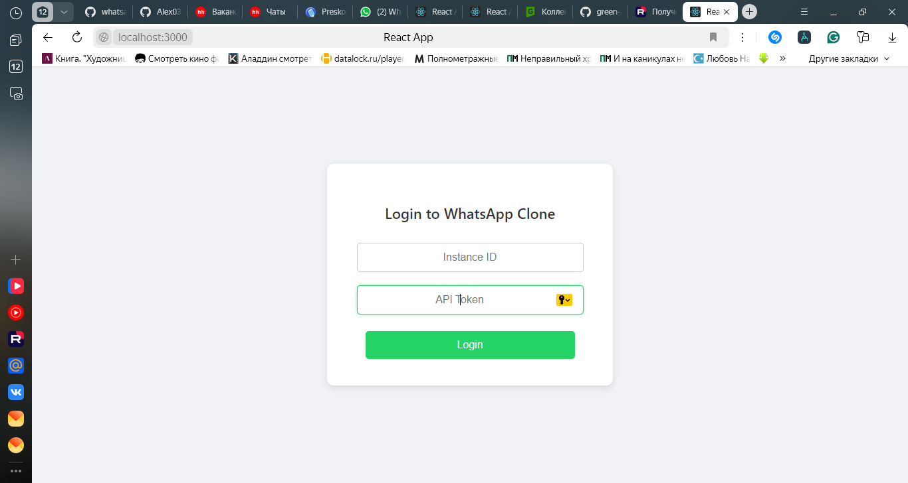
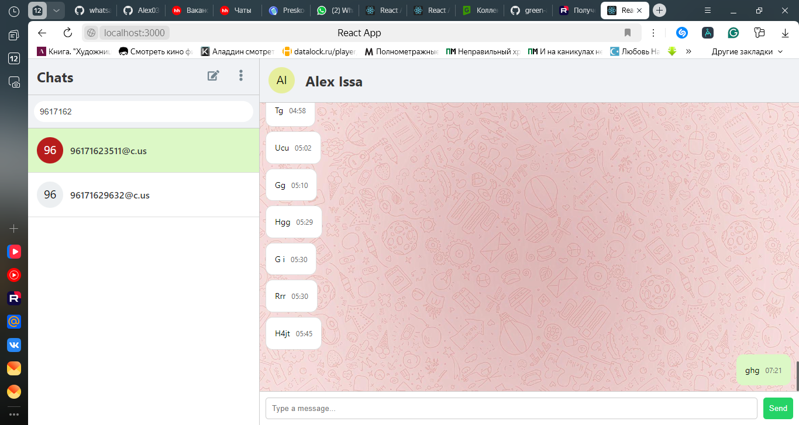
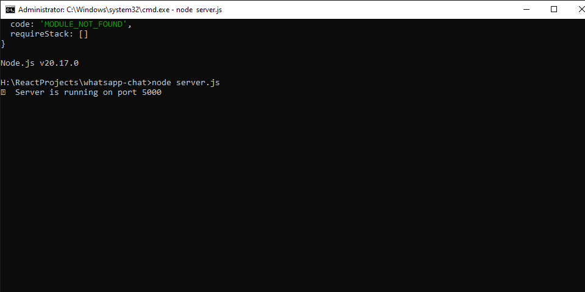
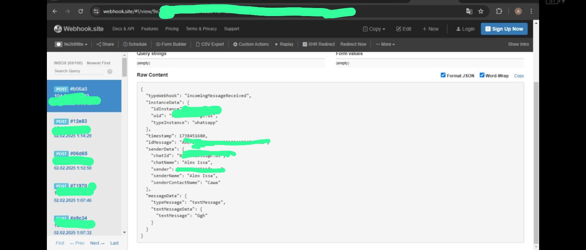

# WhatsApp Chat App

[English version](README.md)


## Обзор

Это веб-приложение на основе React, которое позволяет пользователям отправлять и получать сообщения WhatsApp с помощью **GREEN-API**. Приложение имитирует интерфейс **WhatsApp Web** и обеспечивает общение в реальном времени с помощью HTTP-опроса.

## Функции

- **Аутентификация пользователя:** пользователи вводят свои **idInstance** и **apiTokenInstance** из GREEN-API для доступа к приложению.

### 🔹 Вход с помощью экземпляров



### 🔹 Выход


- **Интерфейс чата:** пользовательский интерфейс, похожий на WhatsApp Web, с перечислением активных разговоров и отображением истории сообщений.

### 🔹 Интерфейс чата


### 🔹 Создание нового чата


- **Отправка сообщений:** пользователи могут отправлять текстовые сообщения на указанный номер WhatsApp.

### 🔹 Отправка сообщений


- **Получение сообщений:** Входящие сообщения извлекаются с помощью метода опроса HTTP API.

### 🔹 Получение сообщения


- **Удаление уведомлений:** После обработки сообщения уведомления удаляются, чтобы позволить приходить новым.

- **Извлечение контактной информации:** Извлекает **имя чата** и **аватар** вместо отображения только идентификаторов чата.

### 🔹 Отображение контактной информации


### 🔹 Типы сообщений (текст, изображения, аудио)


## Используемые технологии

- **React.js** (Frontend)
- **Node.js и Express** (Backend для вызовов API)
- **CSS** (Стилизация)
- **GREEN-API** (служба API WhatsApp)

## Структура проекта

```
whatsapp-chat/
│── public/ # Статические ресурсы (изображения, иконки)
│── src/
│ ├── components/ # Компоненты пользовательского интерфейса
│ │ ├── ChatWindow.js
│ │ ├── ChatWindow.css
│ │ ├── MessageList.js
│ │ ├── MessageList.css
│ │ ├── MessageInput.js
│ │ ├── MessageInput.css
│ │ ├── LoginForm.js
│ │ ├── LoginForm.css
│ ├── pages/ # Главные страницы приложения
│ │ ├── Home.js
│ │ ├── Home.css
│ │ ├── Login.js
│ ├── services/ # Функции сервиса API
│ │ ├── api.js
│ ├── App.js # Главный компонент React
│ ├── index.js # Точка входа
│ ├── index.css # Глобальные стили
│── server.js # Внутренний сервер для прокси API
│── package.json # Зависимости и скрипты
│── README.md # Документация проекта
```

## Настройка и установка

### Предварительные условия

- **Node.js** (рекомендуется v14+)
- **npm или yarn**
- **Учетная запись GREEN-API**

### Шаги для запуска проекта

1. Клонируйте репозиторий:
```bash
git clone https://github.com/Alex03issa/whatsapp-chat.git
cd whatsapp-chat
```
2. Установите зависимости:
```bash
npm install
```
3. Запустите сервер разработки:
```bash
npm start
```
4. Откройте приложение в браузере по адресу:
```
http://localhost:3000
```
5. Войдите, используя **idInstance** и **apiTokenInstance** GREEN-API.

6. Начните новый чат, введя номер WhatsApp.

7. Отправляйте и получайте сообщения в режиме реального времени.

## Интеграция API

### Отправка сообщений

Использует `https://api.green-api.com/waInstance{idInstance}/SendMessage/{apiTokenInstance}`

- Реализовано в `sendMessage()` внутри `api.js`
- Отправляет сообщение на указанный номер WhatsApp.


### Получение сообщений (используя HTTP API)

Использует `https://api.green-api.com/waInstance{idInstance}/ReceiveNotification/{apiTokenInstance}`

- Реализовано в `receiveMessages()` внутри `api.js`
- Использует HTTP для проверки новых сообщений.
- Получает уведомления и фильтрует сообщения только для активных чатов.
- Обрабатывает сообщения и удаляет уведомления после извлечения с помощью `deleteNotification()`.

### Удаление уведомлений

Использует `https://api.green-api.com/waInstance{idInstance}/DeleteNotification/{receiptId}/{apiTokenInstance}`

- Реализовано в `deleteNotification()` внутри `api.js`
- Обеспечивает извлечение только новых сообщений путем удаления обработанных уведомлений.

### Извлечение истории чата

Использует `https://api.green-api.com/waInstance{idInstance}/getChatHistory/{apiTokenInstance}`

- Реализовано в `getChatHistory()` внутри `api.js`
- Извлекает прошлые сообщения для чата.

### Извлечение списка чатов

Использует `https://api.green-api.com/waInstance{idInstance}/getChats/{apiTokenInstance}`

- Реализовано в `getChats()` внутри `api.js`
- Перечисляет все активные разговоры.

### Извлечение контактной информации

Использует `https://api.green-api.com/waInstance{idInstance}/getContactInfo/{apiTokenInstance}`

- Реализовано в `getContactInfo()` внутри `api.js`
- Извлекает **имя чата** и **аватар** для заданного идентификатора чата.

### Извлечение состояния экземпляра

Использует `https://api.green-api.com/waInstance{idInstance}/getStateInstance/{apiTokenInstance}`

- Реализовано в `getInstanceState()` внутри `api.js`
- Проверяет состояние подключения экземпляра WhatsApp.

## Webhook против HTTP API Polling

### Webhook (необязательно: `npm run server` и `REACT_APP_WEBHOOK_SOCKET_URL`)

- Прослушивает новые сообщения **автоматически**.
- Требует **сервера, работающего 24/7**, для обработки входящих данных.
- Более **эффективно**, но требует дополнительной настройки.
- Webhook автоматически отправляет входящие сообщения на сервер, как только они получены.
- Требует постоянно работающего сервера, который сможет обрабатывать входящие запросы.
- В проекте реализовано в server.js, где входящие сообщения передаются в WebSocket.
- Настройка Webhook осуществляется в Instance Settings GREEN-API, где указывается URL сервера.
  
  
  
  
  
### HTTP API Polling (используется в этом проекте)

- Периодически **запрашивает** новые сообщения.
- Работает в **браузере** без необходимости в сервере.
- Проще, но требует **ручного опроса**.  

## Проблемы и отладка

- Если сообщения не получены, убедитесь, что **GREEN-API credentials** действительны.
- Если приложение не отображает сообщения, проверьте **формат ответа API**.
- Убедитесь, что для вызовов API используются правильные **идентификатор экземпляра и токен**.

## Автор

- **Alexander Issa**
- Электронная почта: **[alexander.issa@gmail.com](mailto\:alexander.issa@gmail.com)**
